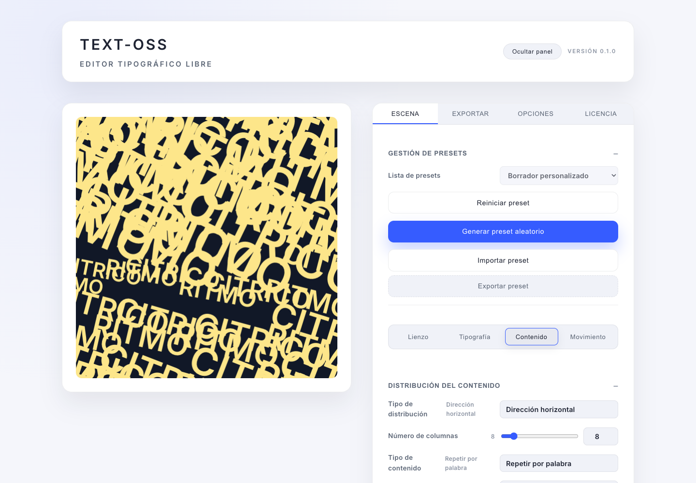

# TEXTROSS / TEXT-OSS

**Código abierto (OSS).**

**Un editor interactivo de tipografía con resultados que se pueden utilizar.**

Permite componer texto sobre un lienzo, cambiar su apariencia y movimiento, guardar una configuración y exportar el resultado. La interfaz actual utiliza el nombre TEXT-OSS; el repositorio se llama `TEXTR_mio_cursor`.

## Enfoque técnico

- Estado de aplicación en React y TypeScript.
- Renderizado con Canvas 2D y controles de animación.
- Selección de fuentes, fondos y configuración de la composición.
- Ajustes reutilizables en JSON y exportación según el formato multimedia.
- Salidas PNG/JPEG y grabación de video compatible con el navegador.

El editor conecta la configuración con un resultado visible y un archivo descargable. Es una herramienta creativa de frontend; las cuentas y una base de datos alojada quedan fuera de su alcance actual.

## Verificación

El 20 de octubre de 2026, una copia local para revisión con el parche de calidad propuesto aprobó lint, las 62 pruebas y la compilación. En Chromium se cambió la composición, se descargó una configuración y se exportó un PNG. Esa comprobación no incluyó la exportación de video ni la compatibilidad con todos los navegadores.

[Repositorio del código](https://github.com/SalvatierraPM/TEXTR_mio_cursor)

Pablo Moraga · Dasein Futures
